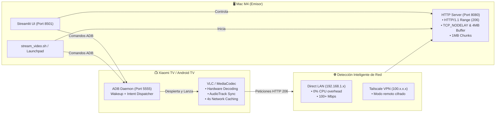

# 📺 TV Streamer (Mac to Android TV / Linux)

[](https://www.python.org/)
[](https://apple.com)
[](https://android.com/tv)
[](https://tailscale.com)
[](LICENSE)

**TV Streamer** es una solución de streaming multimedia *zero-touch* que te permite transmitir cualquier video desde tu Mac (Apple Silicon) a tu Smart TV (Xiaomi, Android TV o Raspberry Pi) a pantalla completa y con un solo clic, sin escribir URLs en el mando a distancia.

Incluye una **Web UI moderna (Streamlit)** accesible desde el ordenador y el móvil, un **servidor HTTP 206 multihilo de alto rendimiento**, **automatización remota vía ADB/SSH**, y una aplicación nativa empaquetada para el **macOS Launchpad**.

---

## 🚀 Flujo de Arquitectura



---

## 🌟 Características Principales

- ⚡ **Zero-Touch Playback:** Envía órdenes automáticas por **ADB (Android)** o **SSH (Linux/Mac)** para despertar la pantalla, esquivar el salvapantallas y abrir el reproductor a pantalla completa sin usar el mando a distancia.
- 🎯 **Enrutamiento Inteligente LAN vs. Tailscale:** 
  - Si estás en casa en la misma red Wi-Fi (`192.168.1.x`), transmite por IP local directa, reduciendo a cero el consumo de CPU de la tele (sin descifrado WireGuard).
  - Si estás fuera de casa, conmuta automáticamente a la red cifrada de **Tailscale** (`100.x.x.x`).
- 🚀 **Servidor HTTP 206 Multihilo (Range Requests):**
  - Implementado con `socketserver.ThreadingMixIn` para permitir múltiples conexiones concurrentes (necesario para leer el índice `moov atom` de archivos MP4).
  - Bloques de streaming de **1 MB** y buffer de socket TCP de **4 MB** con `TCP_NODELAY`.
- 🔊 **Corrección de Desacople Audio/Video:**
  - Resuelve el desfase de 1.5s típico de videos **H.264 con B-Frames** y audio AAC 44.1 kHz en chips MediaTek mediante el motor **AudioTrack** y control de `clock-jitter`.
  - Buffer de red de **4 segundos (`network-caching = 4000`)** para absorber fluctuaciones de Wi-Fi.
- 🍏 **Integración Nativa con macOS:**
  - Paquete `.app` con icono personalizado para el **Launchpad** y Dock.
  - Atajos de terminal (`tv`, `tvstreamer`, `tv-stop`).
  - Extracción automática de carátulas/miniaturas en tiempo real con `ffmpeg`.

---

## 📦 Estructura del Proyecto

```text
tv-streamer/
├── app.py               # Interfaz gráfica moderna en Streamlit
├── stream_manager.py    # Orquestador: ADB, SSH, IP dinámica y ciclo de vida
├── video_server.py      # Servidor HTTP 1.1 multihilo con soporte Range 206
├── stream_video.sh      # Script CLI para streaming rápido desde terminal
├── run.sh               # Lanzador del servicio web
├── stop.sh              # Script de apagado limpio y liberación de puertos
├── config.example.json  # Plantilla de configuración de dispositivos
└── requirements.txt     # Dependencias de Python
```

---

## 🛠️ Instalación y Requisitos

### 1. Requisitos Previos

- **macOS** (Optimizado para Apple Silicon M1/M2/M3/M4).
- **Python 3.10+**.
- **ADB (`android-platform-tools`)**:
  ```bash
  brew install android-platform-tools ffmpeg
  ```
- **Android TV / Xiaomi TV:**
  - Activar **Opciones para desarrolladores** $\rightarrow$ **Depuración por red (ADB)**.
  - Instalar **VLC for Android** desde la Google Play Store.

### 2. Clonar e Instalar Dependencias

```bash
git clone https://github.com/gtrujillovdev-cyber/tv-streamer.git
cd tv-streamer
pip install -r requirements.txt
cp config.example.json config.json
```

---

## 🎬 Guía de Uso

### Método 1: Desde macOS Launchpad
Haz clic en el icono **TV Streamer** en tu Launchpad o abre Spotlight (`Cmd + Espacio`) y escribe `TV Streamer`. El servidor se iniciará y abrirá la interfaz en tu navegador por defecto.

### Método 2: Interfaz Web (Móvil / Desktop)
```bash
./run.sh
```
- **En tu Mac:** [http://localhost:8501](http://localhost:8501)
- **Desde tu móvil en el sofá:** `http://<IP_TAILSCALE>:8501`

### Método 3: Terminal CLI
```bash
# Transmitir a Xiaomi TV
./stream_video.sh ~/Movies/pelicula.mp4 100.90.61.47 android

# Transmitir a Raspberry Pi por SSH
./stream_video.sh ~/Movies/pelicula.mp4 pi@100.95.199.1 linux
```

### 🛑 Detener el Servicio
```bash
./stop.sh
# O usando los alias de terminal:
tv-stop
```

---

## 🔧 Ajustes Clave para Xiaomi / Android TV

Si experimentas tirones o desfase de audio en archivos H.264/MKV de alto bitrate:

1. **Salida de Audio:** En VLC en la tele, ve a **Ajustes $\rightarrow$ Audio $\rightarrow$ Salida de audio** y selecciona **`AudioTrack`** en lugar de OpenSL ES.
2. **Aceleración por Hardware:** Ve a **Ajustes $\rightarrow$ Vídeo $\rightarrow$ Aceleración hardware** y asegúrate de que esté en **Completa**.
3. **Caché de red:** En **Ajustes $\rightarrow$ Avanzado $\rightarrow$ Caché de red**, pon **2000 ms** o **3000 ms**.

---

## 📄 Licencia

Distribuido bajo la Licencia MIT. Consulta `LICENSE` para más detalles.
